# SITRAIN 教师绿色版 Pilot 使用手册

本手册面向第一次使用平台的老师。推荐先按第 1—6 节完成一套 Word + PPT 教材；只翻译一份文件时走第 7 节。文中的截图来自独立解压的 Pilot 试用包，演示材料为新建的合成文件。

## 使用前准备

- Windows 电脑已安装 Microsoft Office，能正常打开 Word 和 PowerPoint。预览和文件重建会调用本机 Office。
- 翻译时电脑可以联网。翻译由已配置的 Qwen-MT 服务完成，解析、预览和数据保存都在本机。
- 在硬盘上为试用包留出空间。请将 ZIP **完整解压**后运行，不要直接在压缩包预览窗口里双击 EXE，也不要只复制 EXE。
- 本 Pilot 是本机单用户版本。每位老师使用自己的解压目录；不要让多位老师共用网络文件夹中的同一个 `sitrain_data`。

## 1. 首次启动：确认翻译服务可用

首次从绿色 ZIP 解压并启动时，先完成一次 LLM 连接测试，再上传教材。

1. **解压整个文件夹并启动。** 将 ZIP 解压到电脑上的一个文件夹，保留其中的所有文件。打开解压得到的 `SITRAIN-Teacher` 文件夹，双击 `SITRAIN-Teacher.exe`。浏览器会打开 `http://127.0.0.1:9000/`；如果没有自动打开，可手动在浏览器地址栏输入该地址。启动时出现的黑色窗口是本地服务，请保持运行。
2. **进入工作台。** 在欢迎页点击“进入本地工作台”。左下角应显示绿色的“本地服务器正常”。全新试用包的 `LLM: Qwen-MT` 指示灯初始为**橙色**，表示翻译服务已配置、尚未测试，并非故障。
3. **打开管理设置。** 点击左侧菜单的“管理设置”，找到 **Qwen-MT** 卡片。试用包已经配置了翻译服务，无需填写 API Key，也无需修改模型或点击“保存”。
4. **测试连接。** 点击 Qwen-MT 卡片中的“测试连接”，等待按钮从“测试中…”恢复。正常联网时通常测试一次即可，页面会提示“连接成功”，卡片状态变为绿色的“当前服务在线”。
5. **核对左下角指示灯。** 确认“本地服务器正常”和 `LLM: Qwen-MT` 前的灯都是**绿色**。这表示本地平台已启动，而且翻译服务连接测试成功，可以开始上传教材。

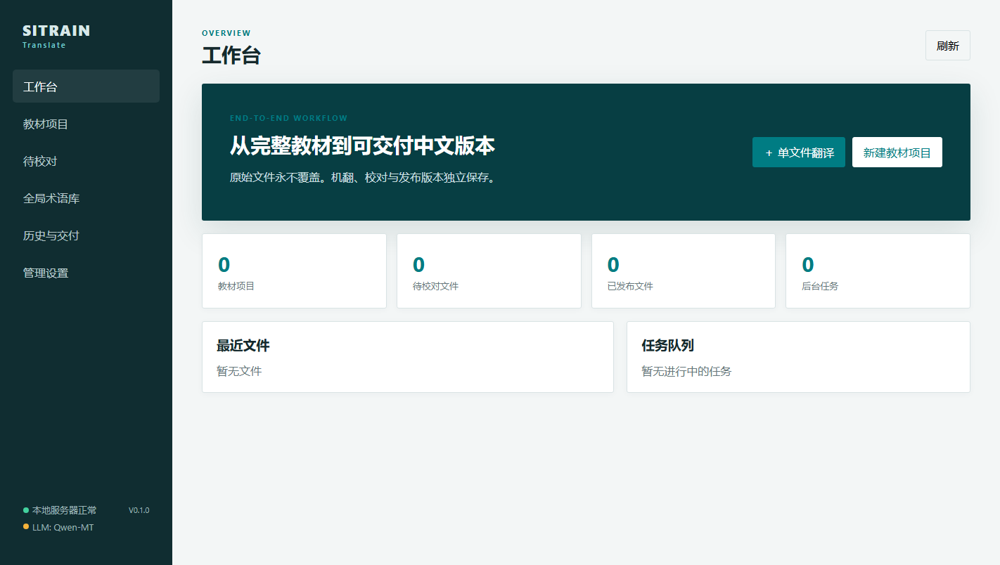

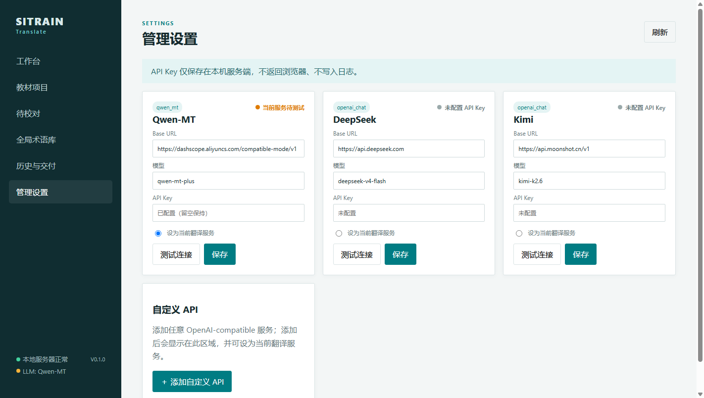

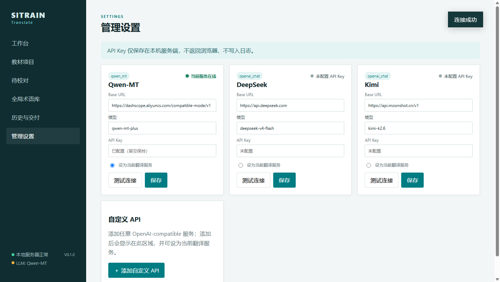

连接成功后，左下角的状态灯也会更新。`V0.1.0` 是当前试用版本号，后续版本可能不同。

### 如果没有变绿

- **LLM 仍为橙色：** 等待几秒后点击页面右上角“刷新”，再查看管理设置中的 Qwen-MT 状态。如果仍显示“当前服务待测试”，重新点击一次“测试连接”。
- **提示连接失败或指示灯变红：** 确认电脑可以上网，稍后重试。若仍失败，记录页面上的报错文字并截图，反馈给试用负责人；先不要开始翻译。
- **网页无法打开或没有“本地服务器正常”：** 确认 `SITRAIN-Teacher.exe` 仍在运行，再手动访问 `http://127.0.0.1:9000/`。若仍无法打开，记录屏幕提示并反馈。

### 启动窗口出现 `/favicon.ico 404 Not Found`

这是浏览器在查找网页标签小图标；当前试用包没有提供该图标，因此启动窗口可能显示一两行红色的 `GET /favicon.ico ... 404 Not Found`。**它不影响页面、翻译、校对或文件下载，无需处理。** 如果同一窗口的 `GET /app.js` 和 `GET /api/health` 显示 `200 OK`，可继续按上面的步骤测试 Qwen-MT 连接。`/api/health` 的 `200 OK` 只说明本地平台能响应，仍需以“测试连接”成功和 LLM 绿灯确认翻译服务可用。

## 2. 选择入口并创建教材项目

确认 LLM 指示灯为绿色后，按手里的材料选择入口：

- **只翻译一份独立文件：** 在“工作台”点击“＋ 单文件翻译”。PPT、Word、PDF 等文件都可以独立处理，不需要先创建教材项目或找齐配套文件。
- **翻译一套教材：** 使用“教材项目”，先建立项目，再导入该项目的教材文件。这适合有多个章节，或同一章节包含 Word 教材和 PPT 课件的情况。

### 两个“新建教材项目”按钮的区别

点击工作台上的“新建教材项目”，会**跳转到“教材项目”页签**；这一步不会立即创建项目，也不会上传文件。

进入“教材项目”页签后，点击“＋ 新建教材项目”，才会打开创建表单。表单分两行：第一行“项目名称”必填，第二行“说明”选填。也可以直接点击左侧菜单的“教材项目”到达这个页签。两条路径最终使用同一个创建流程。

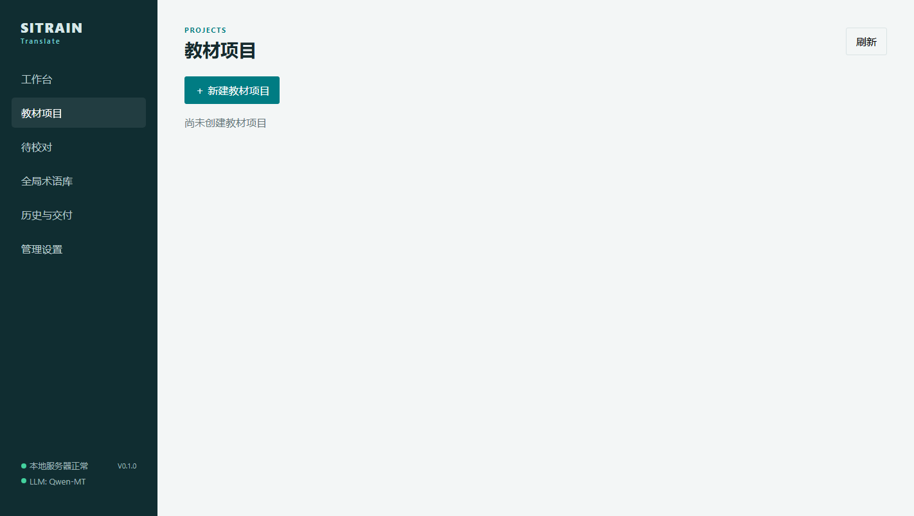

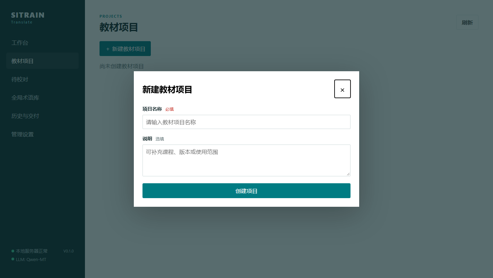

### 建立项目并导入文件

1. 点击“＋ 新建教材项目”，填写**项目名称**；“说明”可以按需填写。点击“创建项目”。此时建立的是空项目，尚未上传或翻译教材。
2. 在“教材项目”列表中打开刚创建的项目，点击“导入整套教材”或“导入 Word + PPT 文件”。这两个按钮打开同一个导入窗口。
3. 将 Word 教材放入 **Word 教材**区域，将 PPT 课件放入 **PPT 课件**区域；可一次选择多个文件。只有 Word 或只有 PPT 的章节也可以导入，无需强行配对。核对源语言和目标语言后，点击“扫描并导入”。当前整套教材导入窗口按文件选择，文件夹名称不参与章节识别。
4. 等待文件预检完成，点击“确认教材结构”，逐章核对顺序、名称、Word/PPT 配对和文件归属；需要时先调整，再点击“保存结构”。保存结构不会立即开始翻译。
5. 结构正确后，点击“开始翻译项目”。平台才会按章节开始翻译。

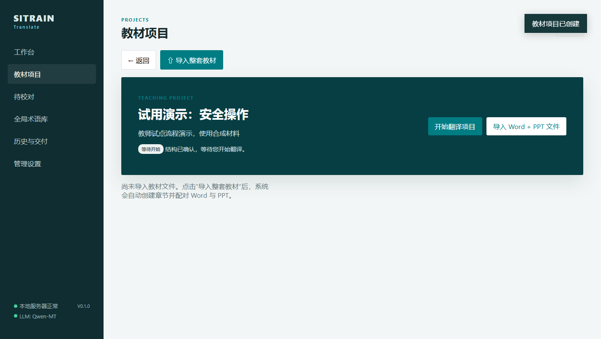

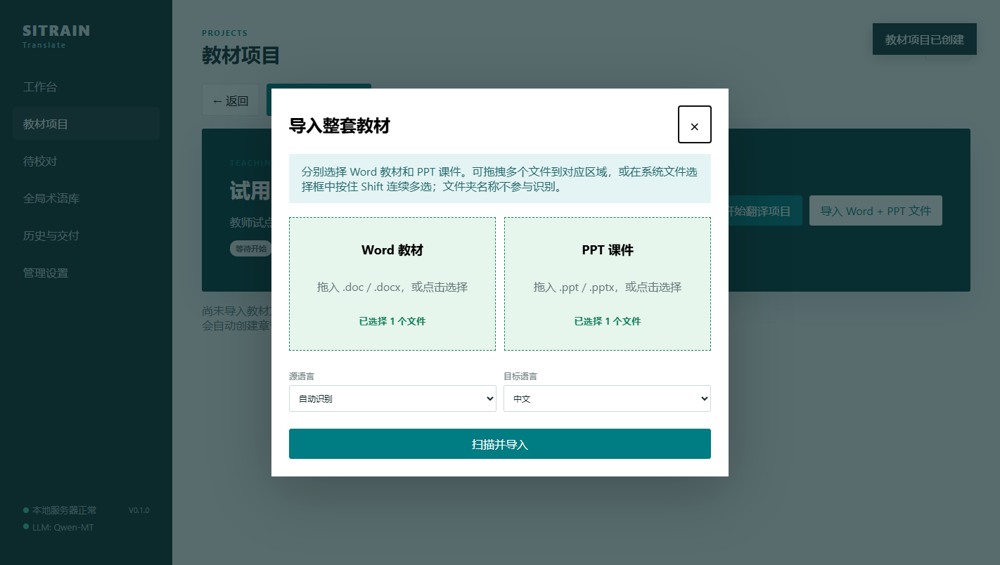

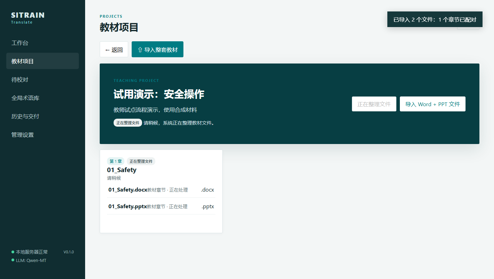

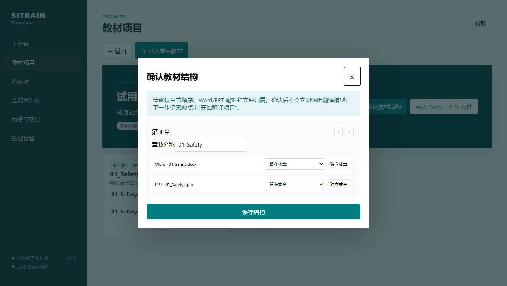

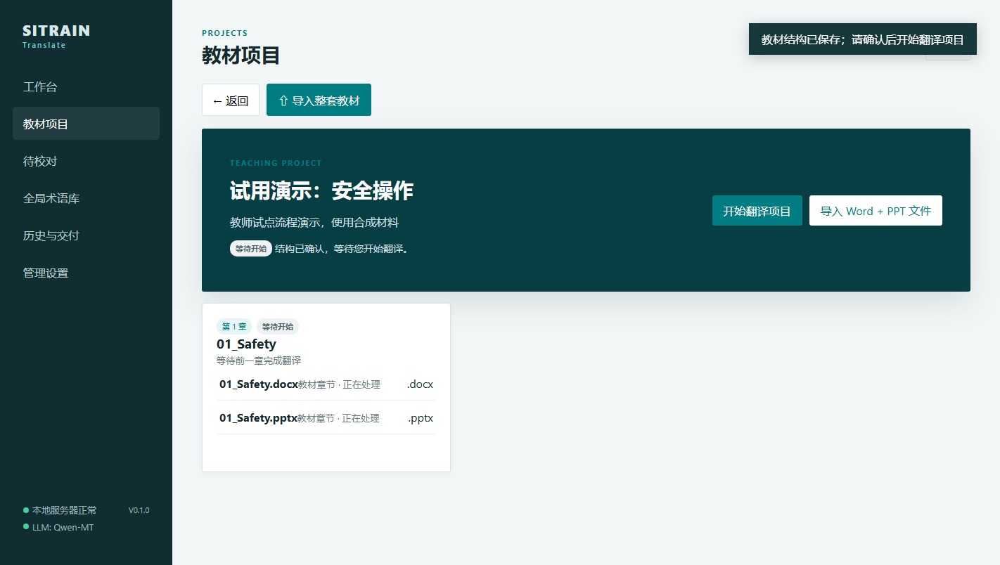

## 3. 等待翻译完成

点击“开始翻译项目”后，翻译任务进入后台队列。工作台会显示任务和进度；文件较多或内容较长时可能需要等待。可以切换页面查看状态，但不要关闭黑色服务窗口或移动整个试用文件夹。单纯关闭浏览器标签不会删除任务和数据，重新访问本机地址即可继续。

当项目或章节出现“开始校对”时，打开对应文件检查译文。**不要只凭任务进度显示完成就直接交付**；先检查术语、漏译、图片文字和版式。

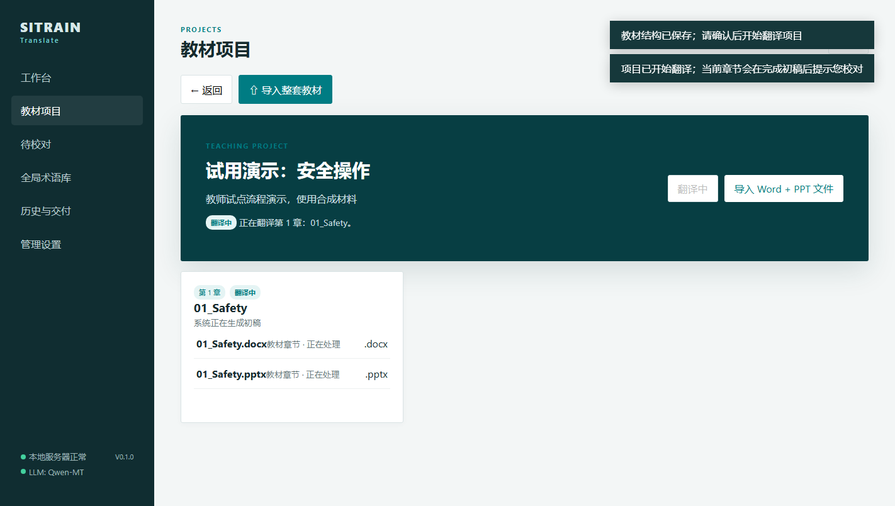

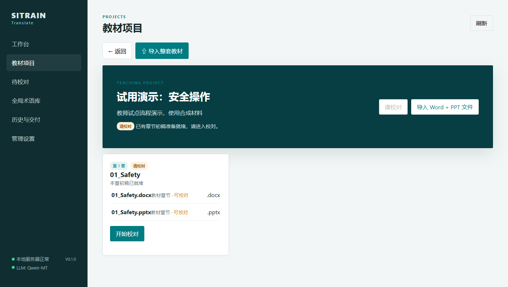

## 4. 校对 Word 与 PPT

### Word 正文

在教材项目中点击“开始校对”，或从左侧“待校对”选择 Word 文件。左侧是文件和页码，中间显示 Word 页面；点击页面上的正文文字，右侧会出现对应的**原文**和**译文**。检查译文后：

1. 需要修改时，直接在右侧译文框内改写，点击“保存修改”。
2. 术语或句子已核对无误时，可点击“确认并写入翻译记忆”，供后续相同内容参考；这不会覆盖以后的人工作业。
3. 逐页检查标题、正文、表格以及图片内文字；用页码或“上一页 / 下一页”切换。
4. 检查完后点击顶部“确认并纳入章节交付”。如果是独立 Word，按钮为“发布并下载 Word”。

Word 中如果有来自同章 PPT 的幻灯片图片，正文校对阶段仍可能保留英文原图；要先完成同章 PPT 校对，再按第 5 节同步图片。

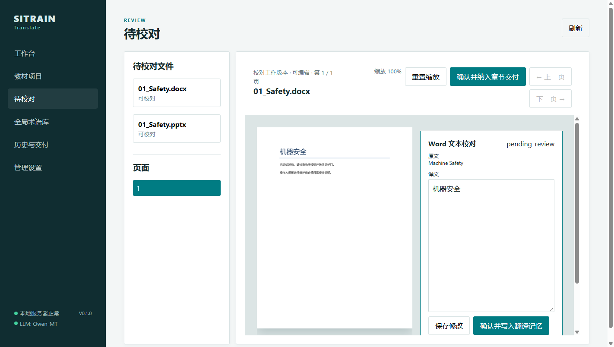

### PPT 页面

在“待校对”选择 PPT 文件，按页检查。点击幻灯片上的文字，或使用页面上方“选择文字或图片…”列表定位对象。修改文字后点击“保存到 PPTX”；页面会重新生成预览，再检查是否溢出、换行不当或遮挡。检查完所有页后，点击“确认并纳入章节交付”；独立 PPT 的按钮为“发布并下载 PPTX”。

有图片文字需要处理时，特别检查图片中文字是否已翻译以及回填位置是否正确。不要把无法确认的图文对应关系当作已完成。

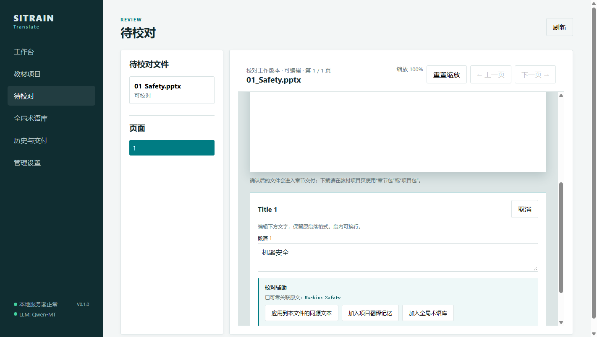

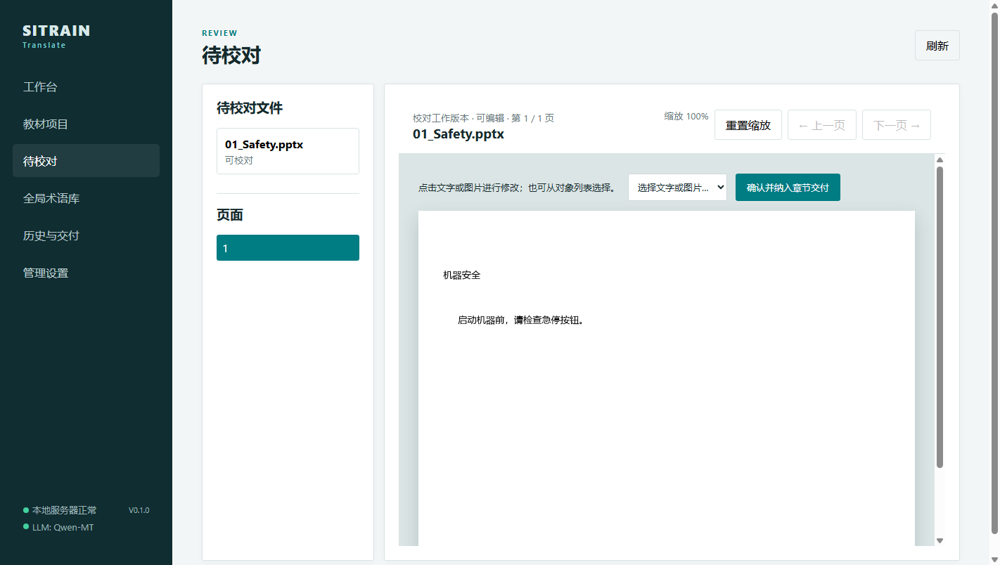

### 遇到“暂不能确认发布”

这是 QA 检查发现需要处理的问题。阅读弹窗中的位置和原文，点击“定位到问题”返回对应页。若是术语缺失，可先使用“自动安全修正术语”，再复查页面；涉及老师已人工修改的内容时，确认用词决定后再继续。不要为绕过提示而随意删改原文或术语。

## 5. 同章 PPT 图片更新到 Word（仅适用于配套教材）

当同一章节同时有 Word 和 PPT、且 Word 内嵌了幻灯片图片时，先分别完成 PPT 与 Word 校对并确认发布。回到“教材项目”，如章节提示“确认图文对应”，点击后执行“开始自动更新”。系统会尝试找出 Word 图片对应的 PPT 页面，并生成**同步后 Word 校验版**。

- 若出现“待确认图片”，逐张比较 Word 原图与推荐 PPT 页面，选择正确页面；不确定时选择“保留 Word 原图”，并把该页记录为待处理问题。
- 点击“进入同步后校验”，重点检查带 **●** 标记的 Word 页：中文图片是否正确、裁剪和尺寸是否合适、正文分页有无异常。
- 检查通过后点击“确认同步后 Word 交付”，再下载章节包或项目包。

如果章节只有 Word 或只有 PPT，不需要执行图片同步。如果 Word 不含幻灯片图片，也无需为同步额外操作。

## 6. 下载并检查交付文件

回到“教材项目”，打开项目。章节完成后可点“⇩ 下载章节包”；整套教材完成后可点“下载项目包”。解压下载的交付包，用 Microsoft Office 打开 Word 和 PPT，抽查封面、目录、各章首尾页、术语以及图片。交付包中的报告列出文件和校验值。

平台始终分别保存原件、机翻、校对和发布版本，不会覆盖上传的英文原件。若最终文件发现问题，记录项目名、章节、文件名、页码和截图，反馈试用负责人。

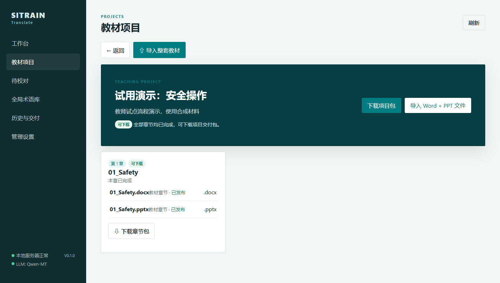

## 7. 只有一份文件时：单文件翻译

1. 在“工作台”点击“＋ 单文件翻译”。点击“选择文件”，选中一份受支持的完整文件；核对源语言和目标语言。“教材项目”保持“独立文件任务”。
2. 点击“上传并预检”，等待文件进入任务队列。预检完成后，平台会开始或提示开始翻译；按工作台状态继续。
3. 翻译完成后，在“待校对”选择文件。Word 和 PPT 按第 4 节操作。
4. Word 校对完点击“发布并下载 Word”；PPT 校对完点击“发布并下载 PPTX”。浏览器会保存输出文件。下载后用对应软件打开，抽查内容和格式。

单文件不需要先创建项目，也不需要凑齐 Word/PPT 配对。平台允许上传 `.pptx/.ppt`、`.docx/.doc`、`.xlsx/.xls`、`.pdf`、`.csv/.tsv`、`.txt/.md/.json/.html/.htm`。本 Pilot 的图文校对流程以 **Word/PPT** 为主要试用范围；其他格式如页面只显示预览、无法校对或下载，请先记录问题，暂勿作为可交付结果。旧版 Office 格式会先转换为现代工作副本，输出文件可能为 `.pptx/.docx/.xlsx`；务必检查版式。独立图片、音视频和压缩包不能作为翻译文件上传。

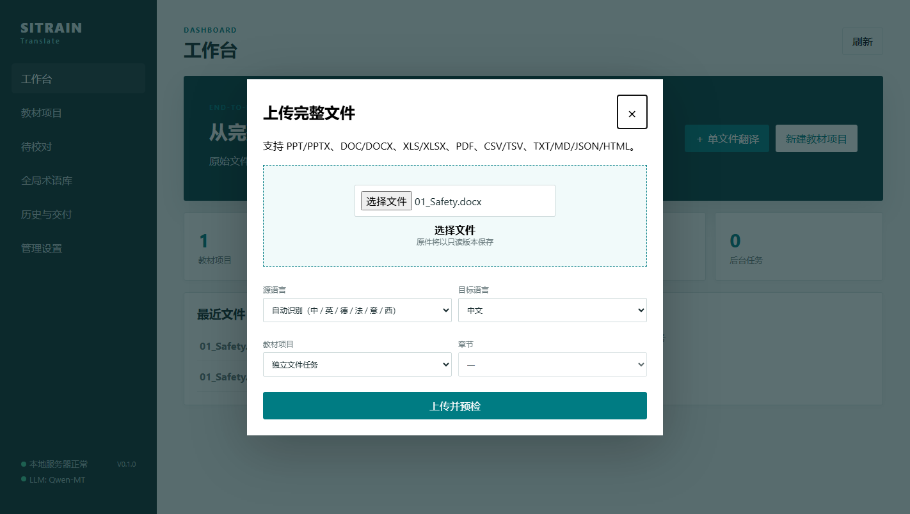

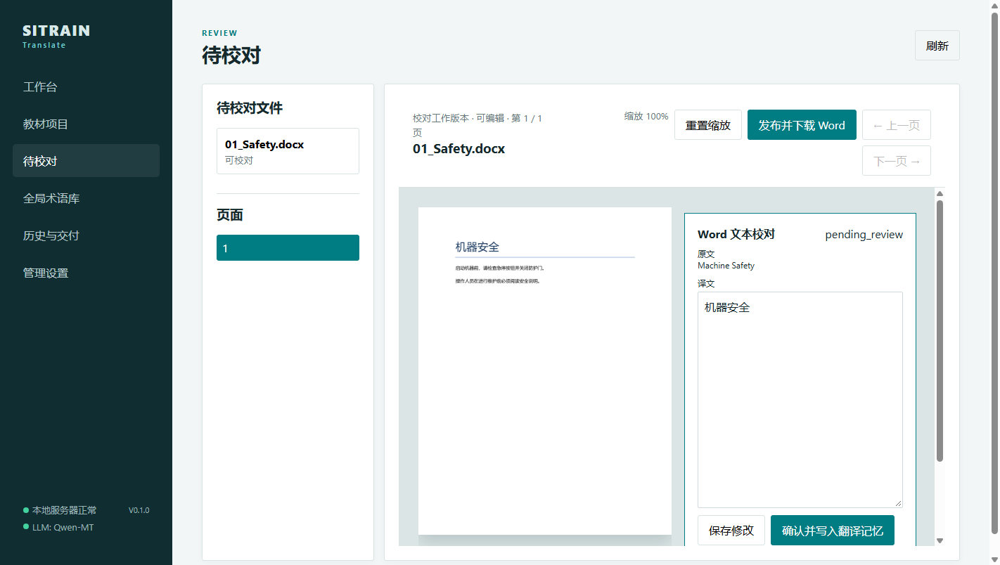

## 8. 可选：维护全局术语

左侧“全局术语库”适用于本机所有项目和单文件。点击“＋ 添加术语”，填写英文术语和中文标准译法；需要识别其他英文写法时填写“英文别名”。可以先“下载 Excel 模板/术语表”，在 Excel 中维护后再“导入术语表”。导入后检查重复或无效行的提示。重要术语最好在开始翻译前准备好，翻译后的 QA 仍需人工核对。

## 9. 关闭、再次打开与数据备份

完成操作后，先等后台任务结束，再关闭浏览器和黑色服务窗口。下次仍从同一个解压文件夹双击 `SITRAIN-Teacher.exe`，数据会继续保存在该文件夹的 `sitrain_data` 子目录。**不要只复制 EXE 换电脑，也不要在更新试用包时直接覆盖 `sitrain_data`。** 更新前先备份整个 `sitrain_data` 文件夹，并保留旧 ZIP，确认新版本能打开历史项目后再继续工作。

## 10. 常见问题与反馈信息

- **LLM 灯为橙色：** 尚未完成连接测试；到“管理设置”测试 Qwen-MT。红色时先检查网络并重试。
- **浏览器打不开：** 确认 EXE 的黑色窗口仍在运行，手动输入 `http://127.0.0.1:9000/`。若端口被其他程序占用，请截图启动窗口中的错误。
- **翻译长时间没有进度：** 回工作台看任务队列，稍等后点“刷新”；记录文件名和屏幕提示，不要反复上传同一文件。
- **校对页无法预览或交付文件版式异常：** 确认 Microsoft Office 已安装且文件能在 Office 打开；记录文件名和页码，保留原件、下载结果与截图供排查。
- **启动窗口出现 `/favicon.ico 404 Not Found`：** 只是网页图标未找到，不影响翻译；以页面正常打开、LLM 连接测试成功为准。

反馈时请提供：所用 Pilot ZIP 的文件名、Windows 和 Office 版本、发生问题的步骤、项目/文件名、页码、页面或启动窗口截图，以及可复现的示例文件。不要在聊天或邮件中发送 API Key。
